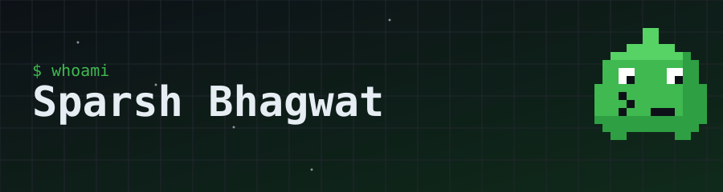

### Hi, I'm Sparsh 👋
**I build backends, databases and ML systems — and I like them reliable.**

---

## 🧰 Tech stack

## 🚀 Featured projects

| Project | What it is | Stack |
|---|---|---|
| [**LedgerCore**](https://github.com/bhagwatSparsh/ledgercore) | Double-entry ledger with row-level security and partitioning | PostgreSQL · TypeScript · React · Redis · Docker |
| [**fl-edge-ids**](https://github.com/bhagwatSparsh/fl-edge-ids) | Federated-learning intrusion detection for edge IoT | PyTorch · Flower · SHAP · Mininet |
| [**gender-bias-llm-audit**](https://github.com/bhagwatSparsh/gender-bias-llm-audit) | Counterfactual audit of gender bias in LLMs | Python · Statistics |
| [**Transaction-Fraud-Outlier-Detector**](https://github.com/bhagwatSparsh/Transaction-Fraud-Outlier-Detector) | Outlier-based transaction fraud detection | Python |
| [**financial-performance-dashboard**](https://github.com/bhagwatSparsh/financial-performance-dashboard) | Financial KPI dashboard | Power BI |

## 📊 GitHub stats

Thanks for stopping by — the pixel mascot is original art made for this profile.

